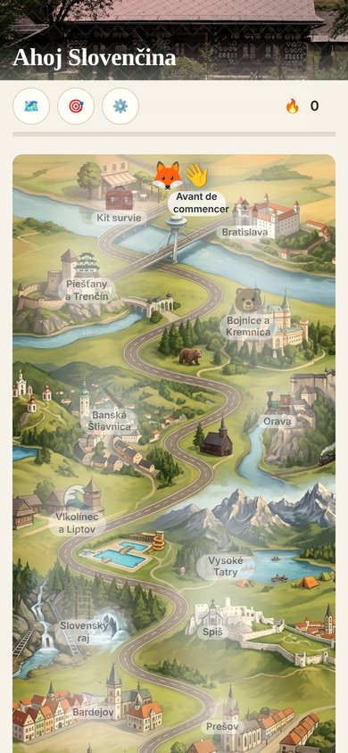
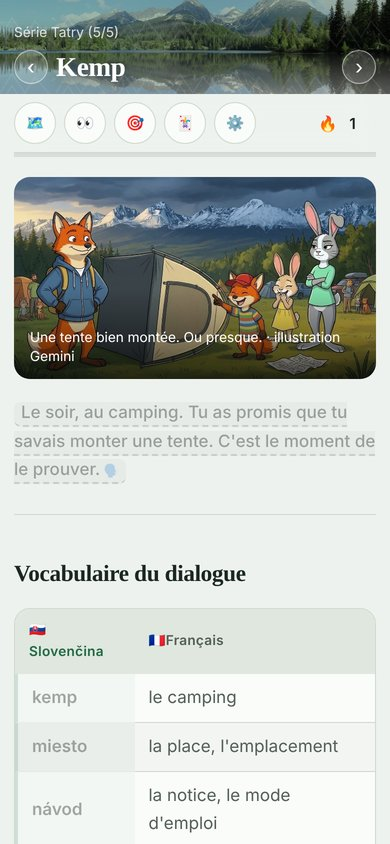
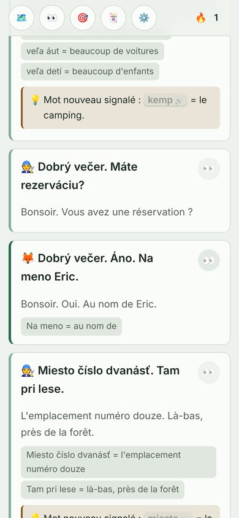
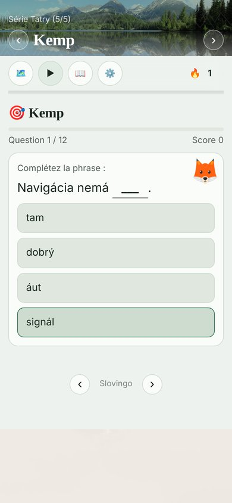

[French version](README_fr.md) [Slovak version](README_sk.md)

# Slovingo

Learn a language without an app, without an account, without a server. Just text files, and a Python script that turns them into a small website. :)

<p align="center">
  
  
  
  
</p>

## 🦊 The courses

| Course | For whom | Online |
|---|---|---|
| **Ahoj Slovenčina!**: Slovak on a road trip, from Bratislava to Košice | French-speaking adults | [Slovingo-sk-fr](https://lstux.github.io/Slovingo-sk-fr/) |
| **Zajko**: a summer holiday in the Tatras | French-speaking kids, 8–12 | [Slovingo-sk-fr-kids](https://lstux.github.io/Slovingo-sk-fr-kids/) |
| **Zajko Friends**: an adventure from Košice to Bratislava | French-speaking teens, 12–16 | [Slovingo-sk-fr-friends](https://lstux.github.io/Slovingo-sk-fr-friends/) |
| **Dis bonjour!**: French | Slovak speakers | [Slovingo-fr-sk](https://lstux.github.io/Slovingo-fr-sk/) |
| **Líštička**: French for young Slovaks (pilot) | Slovak-speaking kids | [repo](https://github.com/lstux/Slovingo-fr-sk-kids) |
| **Fuchsbau**: German in the Black Forest | French-speaking kids, 8+ | [Slovingo-de-fr-kids](https://lstux.github.io/Slovingo-de-fr-kids/) |
| German | French-speaking adults | [repo](https://github.com/lstux/Slovingo-de-fr) |
| Breton (very early, no voice yet) | French speakers | [repo](https://github.com/lstux/Slovingo-bzh-fr) |

One click and you're off. No sign-up!

## 🎯 Why Slovingo?

At first, I just wanted to learn Slovak. Except the well-known apps don't have Slovak courses… I tried Ling, wasn't convinced (and it turns paid after the first course). What I wanted was to hear the words while reading them, and to write my own vocabulary and dialogue cards.

So I made my own. No account, no subscription, no server that can vanish tomorrow: Markdown files, and a small Python script that turns them into a site you can use even offline.

And then it got a bit out of hand: a fox and a hare showed up, then stories, maps, illustrations, courses for kids, for teens… and even little games. ^^

## ✨ What's inside

- **Everything can be heard**: tap a word or a sentence and it's read aloud, in the language you're learning as well as in French (browser text-to-speech).
- **Sentences get unpacked**: a natural translation, then the breakdown piece by piece, and a short grammar note when needed.
- **Dialogues** with characters, each with an avatar and a voice, and a button to play the whole thing.
- **Exercises generated automatically** from the cards (multiple choice, fill-in-the-blanks, listening, word order, matching), and you can also write them by hand.
- **An adventure map** on the home page: each series is a stop, and the road lights up as you progress. Nothing is ever locked.
- **Maps inside the cards**, to see where the action takes place (a pin or a route).
- **Step-by-step reading**, card by card, for longer sheets.
- **Your progress stays with you**: everything is stored in the browser, nothing is sent anywhere. You can export it or import it as a file.
- **Installable as an app (PWA)**: once installed, the course works offline, even if the site were to disappear one day.

## ⚠️ Written with AI

The cards are written with AI assistance, and some illustrations are AI-generated.

- **Slovak for French speakers**: I review and fix it as I follow the course myself. A proper review by Slovak speakers would be amazing!
- **French for Slovak speakers**: much harder for me to review properly.

If you spot a mistake, an issue or a PR is very welcome! 🙏

## 📚 Create a course in another language

Slovingo is a generic engine: one language = one `lang.json` file + Markdown cards.

A card is regular Markdown, with a few extra conventions (the **SMD** format):

```markdown
# At the café

| Slovak | French  |
|--------|---------|
| káva   | le café |
| čaj    | le thé  |

! 🐰 Dáš si kávu?
> Tu prends un café ?
> Dáš si = tu prends
> kávu = un café
+ « Káva » devient « kávu » après « dať si » : c'est l'accusatif.

%: Where we are
% 48.1436, 17.1090 | {{Hlavné námestie}}
```

- `!` a sentence to listen to (with the emoji of the character speaking), `>` its translation then the breakdown, `+` a note.
- `{{…}}`: a clickable, spoken word. `@`: an image. `%`: a map.

Nothing to touch in Python: everything language-dependent (voice, colours, title, characters, home map) lives in `lang.json`. It's all explained in [Lang-json.md](docs/Lang-json.md) and [Format-SMD.txt](docs/Format-SMD.txt) (in French).

```bash
git clone https://github.com/lstux/Slovingo.git
cd Slovingo
python3 src/langs.py sk-fr           # fetch an existing course as a template
cp -r langs/sk-fr langs/my-language
rm -rf langs/my-language/.git
python3 src/publish.py --lang-dir langs/my-language
```

There are also a few editors in `tools/` (exercises, images, maps, `lang.json`) so you don't have to do everything by hand.

## 🛠️ Install locally

```bash
git clone https://github.com/lstux/Slovingo.git
cd Slovingo
python3 src/langs.py                 # pick the courses to fetch (interactive)
# or: python3 src/langs.py sk-fr de-fr-kids   |   --all   |   --list   |   de-fr-kids@some-branch
python3 src/tower.py                 # the control tower: courses, dependencies, build and publish (console)
python3 src/publish.py --lang-dir langs/sk-fr
# then open langs/sk-fr/dist/index.html in a browser
```

Python 3.8+ and Pillow (`pip install -r requirements.txt`), runs anywhere (Linux, macOS, Windows). Details in [INSTALL.md](INSTALL.md), and for the control tower in [Tower.md](docs/Tower.md).

Each course publishes itself on GitHub Pages on every push. And to install all the courses at once as a single app, there's a shared home page: see [Launcher.md](docs/Launcher.md).

## 🤝 Contributing

Help is very welcome, especially for reviewing the courses!

- **Fix or add a card**: fork → edit in the course's `md/` → test with `python3 src/publish.py --lang-dir langs/<code>` → PR
- **Report a bug**: open an issue (what's broken + browser/OS)
- **Suggest a language**: open an issue (the language, its ISO code, why it's missing elsewhere)

## 📝 License

The engine, cards and exercises in these repositories are under GPL v3, see [LICENSE](LICENSE). For your own cards, outside these repositories, you pick whatever license you like (CC-BY, public domain…).

---

**Questions?** Open an issue, or just clone and try it. 🚀
