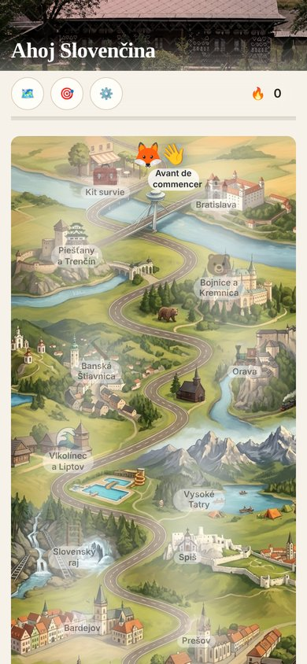
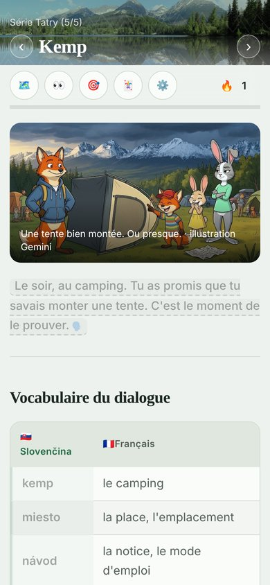
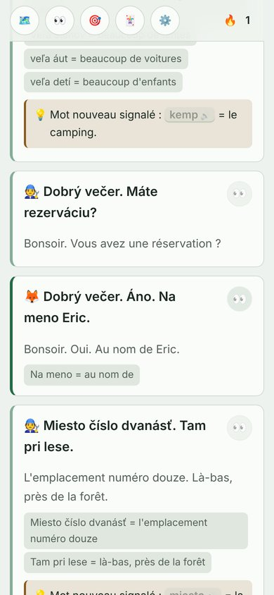
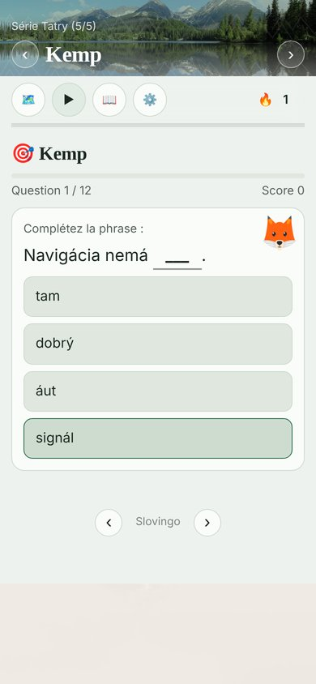

[English version](README.md) [Slovak version](README_sk.md)

# Slovingo

Apprendre une langue sans appli, sans compte, sans serveur. Juste des fiches en texte, et un script Python qui en fait un petit site web. :)

<p align="center">
  
  
  
  
</p>

## 🦊 Les cours

| Cours | Pour qui | En ligne |
|---|---|---|
| **Ahoj Slovenčina!** : le slovaque en roadtrip, de Bratislava à Košice | adultes francophones | [Slovingo-sk-fr](https://lstux.github.io/Slovingo-sk-fr/) |
| **Zajko** : des vacances dans les Tatras | enfants francophones, 8-12 ans | [Slovingo-sk-fr-kids](https://lstux.github.io/Slovingo-sk-fr-kids/) |
| **Zajko Friends** : une aventure de Košice à Bratislava | ados francophones, 12-16 ans | [Slovingo-sk-fr-friends](https://lstux.github.io/Slovingo-sk-fr-friends/) |
| **Dis bonjour!** : le français | slovacophones | [Slovingo-fr-sk](https://lstux.github.io/Slovingo-fr-sk/) |
| **Líštička** : le français pour les petits Slovaques (pilote) | enfants slovacophones | [repo](https://github.com/lstux/Slovingo-fr-sk-kids) |
| **Fuchsbau** : l'allemand dans la Forêt-Noire | enfants francophones, dès 8 ans | [Slovingo-de-fr-kids](https://lstux.github.io/Slovingo-de-fr-kids/) |
| L'allemand | adultes francophones | [repo](https://github.com/lstux/Slovingo-de-fr) |
| Le breton (tout petit début, pas encore de voix) | francophones | [repo](https://github.com/lstux/Slovingo-bzh-fr) |

Un clic, et c'est parti. Pas d'inscription !

## 🎯 Pourquoi Slovingo ?

Au départ, je voulais juste apprendre le slovaque. Sauf que les applis connues n'ont pas de cours de slovaque… J'ai testé Ling, sans être convaincu (et c'est payant après le premier cours). Moi, je voulais écouter les mots en les lisant, et pouvoir écrire mes propres fiches de vocabulaire et de dialogues.

Alors j'ai fait le mien. Pas de compte, pas d'abonnement, pas de serveur qui peut disparaître demain : des fichiers Markdown, et un petit script Python qui en fait un site consultable même hors ligne.

Et puis ça a un peu dérapé : un renard et une hase sont arrivés, puis des histoires, des cartes, des illustrations, des cours pour les enfants, pour les ados… et même des petits jeux. ^^

## ✨ Ce qu'il y a dedans

- **Tout s'écoute** : on touche un mot ou une phrase, et c'est lu, dans la langue apprise comme en français (synthèse vocale du navigateur).
- **Les phrases se décortiquent** : traduction naturelle, puis le détail morceau par morceau, et une petite remarque de grammaire quand il faut.
- **Des dialogues** avec des personnages, un avatar et une voix chacun, et un bouton pour tout lire d'un coup.
- **Des exercices générés tout seuls** à partir des fiches (QCM, phrases à trous, écoute, remettre dans l'ordre, relier), et on peut aussi les écrire à la main.
- **Une carte d'aventure** en page d'accueil : chaque série est une étape, et la route s'éclaire au fil des progrès. Rien n'est jamais verrouillé.
- **Des cartes dans les fiches**, pour voir où se passe l'action (une épingle ou un trajet).
- **Une lecture pas à pas**, carte par carte, pour les fiches un peu longues.
- **Ta progression reste chez toi** : tout est stocké dans le navigateur, rien n'est envoyé nulle part. Et on peut l'exporter ou l'importer en un fichier.
- **Installable en appli (PWA)** : une fois installé, le cours marche hors ligne, même si le site disparaissait un jour.

## ⚠️ Contenu écrit avec l'IA

Les fiches sont écrites avec l'aide de l'IA, et certaines illustrations sont générées par IA.

- **Le slovaque pour francophones** : je le relis et je le corrige au fur et à mesure que je suis le cours. Une vraie relecture par des Slovaques, ce serait le top !
- **Le français pour slovacophones** : beaucoup plus dur à relire sérieusement pour moi.

Si tu repères une bourde, une issue ou une PR est la bienvenue ! 🙏

## 📚 Créer un cours dans une autre langue

Slovingo est un moteur générique : une langue = un fichier `lang.json` + des fiches en Markdown.

Une fiche, c'est du Markdown classique, avec quelques petites conventions en plus (le format **SMD**) :

```markdown
# Au café

| Slovaque | Français |
|----------|----------|
| káva     | le café  |
| čaj      | le thé   |

! 🐰 Dáš si kávu?
> Tu prends un café ?
> Dáš si = tu prends
> kávu = un café
+ « Káva » devient « kávu » après « dať si » : c'est l'accusatif.

%: Où on est
% 48.1436, 17.1090 | {{Hlavné námestie}}
```

- `!` une phrase à écouter (avec l'emoji du personnage qui parle), `>` sa traduction puis le détail, `+` une remarque.
- `{{…}}` : un mot cliquable et prononcé. `@` : une image. `%` : une carte.

Rien à toucher côté Python : tout ce qui dépend de la langue (voix, couleurs, titre, personnages, carte d'accueil) est dans `lang.json`. Tout est expliqué dans [Lang-json.md](docs/Lang-json.md) et [Format-SMD.txt](docs/Format-SMD.txt).

```bash
git clone https://github.com/lstux/Slovingo.git
cd Slovingo
python3 src/langs.py sk-fr           # récupérer un cours existant comme modèle
cp -r langs/sk-fr langs/ma-langue
rm -rf langs/ma-langue/.git
python3 src/publish.py --lang-dir langs/ma-langue
```

Il y a aussi quelques éditeurs dans `tools/` (exercices, images, cartes, `lang.json`) pour ne pas tout faire à la main.

## 🛠️ Installer en local

```bash
git clone https://github.com/lstux/Slovingo.git
cd Slovingo
python3 src/langs.py                 # choisir les cours à récupérer (interactif)
# ou : python3 src/langs.py sk-fr de-fr-kids   |   --all   |   --list   |   de-fr-kids@une-branche
python3 src/tower.py                 # la tour de contrôle : cours, dépendances, build et publication (console)
python3 src/publish.py --lang-dir langs/sk-fr
# puis ouvrir langs/sk-fr/dist/index.html dans un navigateur
```

Python 3.8+ et Pillow (`pip install -r requirements.txt`), ça tourne partout (Linux, macOS, Windows). Détails dans [INSTALL.md](INSTALL.md), et pour la tour de contrôle dans [Tower.md](docs/Tower.md).

Chaque cours se publie tout seul sur GitHub Pages à chaque push. Et pour installer tous les cours d'un coup en une seule appli, il y a une page d'accueil commune : voir [Launcher.md](docs/Launcher.md).

## 🤝 Contribuer

Les coups de main sont les bienvenus, surtout pour relire les cours !

- **Corriger ou ajouter une fiche** : fork → modifier dans `md/` du cours → tester avec `python3 src/publish.py --lang-dir langs/<code>` → PR
- **Signaler un bug** : ouvrir une issue (ce qui ne marche pas + navigateur/OS)
- **Proposer une langue** : ouvrir une issue (la langue, son code ISO, pourquoi elle manque ailleurs)

## 📝 Licence

Le moteur, les fiches et les exercices de ces dépôts sont sous GPL v3, voir [LICENSE](LICENSE). Pour tes propres fiches, en dehors de ces dépôts, tu choisis la licence que tu veux (CC-BY, domaine public…).

---

**Des questions ?** Ouvre une issue, ou clone et essaie directement. 🚀
