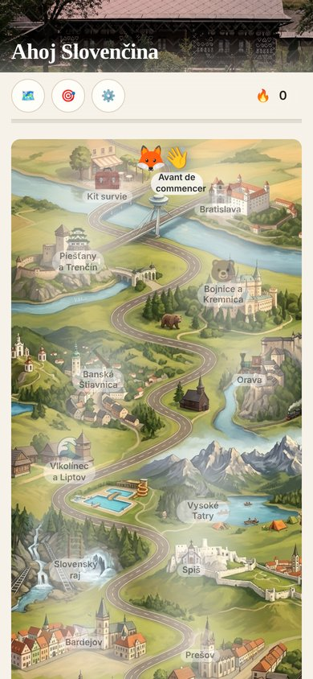
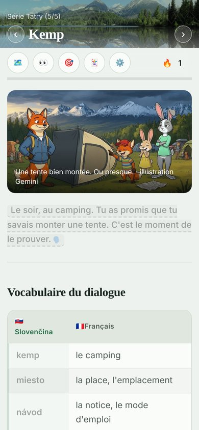
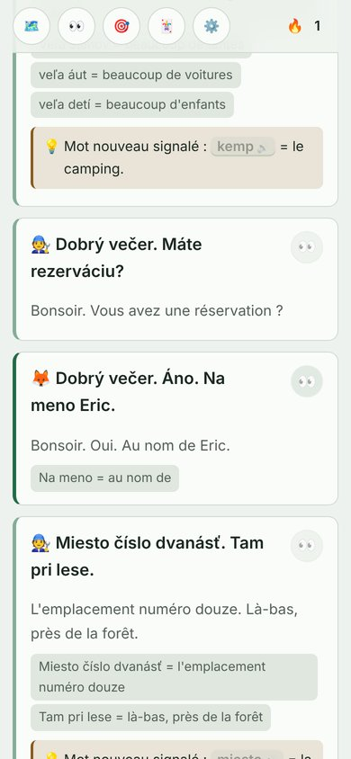
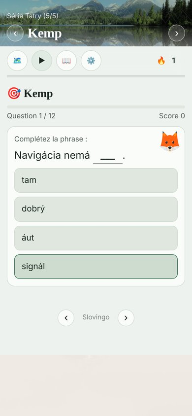

[English version](README.md) [French version](README_fr.md)

*Keby tento README skontroloval niekto zo Slovenska, bolo by to určite vítané :)*

# Slovingo

Uč sa jazyk bez aplikácie, bez účtu, bez servera. Len textové kartičky a Python skript, ktorý z nich urobí malú webovú stránku. :)

<p align="center">
  
  
  
  
</p>

## 🦊 Kurzy

| Kurz | Pre koho | Online |
|---|---|---|
| **Ahoj Slovenčina!** : slovenčina na výlete autom, z Bratislavy do Košíc | dospelí frankofóni | [Slovingo-sk-fr](https://lstux.github.io/Slovingo-sk-fr/) |
| **Zajko** : prázdniny v Tatrách | frankofónne deti, 8 – 12 rokov | [Slovingo-sk-fr-kids](https://lstux.github.io/Slovingo-sk-fr-kids/) |
| **Zajko Friends** : dobrodružstvo z Košíc do Bratislavy | frankofónni tínedžeri, 12 – 16 rokov | [Slovingo-sk-fr-friends](https://lstux.github.io/Slovingo-sk-fr-friends/) |
| **Dis bonjour!** : francúzština | Slováci | [Slovingo-fr-sk](https://lstux.github.io/Slovingo-fr-sk/) |
| **Líštička** : francúzština pre malých Slovákov (pilotná verzia) | slovenské deti | [repozitár](https://github.com/lstux/Slovingo-fr-sk-kids) |
| **Fuchsbau** : nemčina v Schwarzwalde | frankofónne deti od 8 rokov | [Slovingo-de-fr-kids](https://lstux.github.io/Slovingo-de-fr-kids/) |
| Nemčina | dospelí frankofóni | [repozitár](https://github.com/lstux/Slovingo-de-fr) |
| Bretónčina (úplný začiatok, zatiaľ bez hlasu) | frankofóni | [repozitár](https://github.com/lstux/Slovingo-bzh-fr) |

Jeden klik a ideš. Bez registrácie!

## 🎯 Prečo Slovingo?

Na začiatku som sa chcel len naučiť po slovensky. Lenže známe aplikácie slovenčinu nemajú… Skúsil som Ling, ale nepresvedčil ma (a po prvom kurze je platený). Chcel som počuť slová, keď ich čítam, a písať si vlastné kartičky so slovíčkami a dialógmi.

Tak som si urobil vlastnú. Žiadny účet, žiadne predplatné, žiadny server, ktorý môže zajtra zmiznúť: súbory v Markdowne a malý Python skript, ktorý z nich urobí stránku, čo funguje aj offline.

A potom sa to trochu vymklo z rúk: prišla líška a zajačica, potom príbehy, mapy, ilustrácie, kurzy pre deti, pre tínedžerov… a dokonca aj malé hry. ^^

## ✨ Čo v tom je

- **Všetko sa dá vypočuť**: klikneš na slovo alebo vetu a prečíta sa, v jazyku, ktorý sa učíš, aj vo francúzštine (syntéza reči v prehliadači).
- **Vety sa rozoberú**: prirodzený preklad, potom rozbor po častiach a krátka gramatická poznámka, keď treba.
- **Dialógy** s postavami, každá má svoj avatar a svoj hlas, a tlačidlo, ktoré prečíta celý dialóg.
- **Cvičenia sa vytvárajú automaticky** z kartičiek (výber z možností, doplňovanie, počúvanie, poradie slov, spájanie), a dajú sa písať aj ručne.
- **Mapa dobrodružstva** na úvodnej stránke: každá séria je zastávka a cesta sa rozsvecuje, ako postupuješ. Nič nie je nikdy zamknuté.
- **Mapy priamo v kartičkách**, aby bolo vidieť, kde sa dej odohráva (špendlík alebo trasa).
- **Čítanie krok za krokom**, kartičku po kartičke, pre dlhšie lekcie.
- **Tvoj pokrok zostáva u teba**: všetko sa ukladá v prehliadači, nič sa nikam neposiela. Dá sa exportovať aj importovať ako súbor.
- **Dá sa nainštalovať ako aplikácia (PWA)**: po inštalácii kurz funguje offline, aj keby stránka jedného dňa zmizla.

## ⚠️ Písané s pomocou AI

Kartičky sú písané s pomocou AI a niektoré ilustrácie sú generované AI.

- **Slovenčina pre frankofónov**: kontrolujem a opravujem ju priebežne, ako kurz sám prechádzam. Skutočná kontrola od Slovákov by bola super!
- **Francúzština pre Slovákov**: pre mňa oveľa ťažšie poriadne skontrolovať.

Ak nájdeš chybu, issue alebo PR je veľmi vítaný! 🙏

## 📚 Ako vytvoriť kurz v inom jazyku

Slovingo je univerzálny engine: jeden jazyk = jeden súbor `lang.json` + kartičky v Markdowne.

Kartička je obyčajný Markdown s niekoľkými konvenciami navyše (formát **SMD**):

```markdown
# V kaviarni

| Slovensky | Francúzsky |
|-----------|------------|
| káva      | le café    |
| čaj       | le thé     |

! 🐰 Dáš si kávu?
> Tu prends un café ?
> Dáš si = tu prends
> kávu = un café
+ « Káva » devient « kávu » après « dať si » : c'est l'accusatif.

%: Kde sme
% 48.1436, 17.1090 | {{Hlavné námestie}}
```

- `!` veta na vypočutie (s emoji postavy, ktorá hovorí), `>` jej preklad a potom rozbor, `+` poznámka.
- `{{…}}`: klikateľné slovo, ktoré sa prečíta. `@`: obrázok. `%`: mapa.

V Pythone netreba nič meniť: všetko, čo závisí od jazyka (hlas, farby, názov, postavy, mapa na úvodnej stránke), je v `lang.json`. Všetko je vysvetlené v [Lang-json.md](docs/Lang-json.md) a [Format-SMD.txt](docs/Format-SMD.txt) (po francúzsky).

```bash
git clone https://github.com/lstux/Slovingo.git
cd Slovingo
python3 src/langs.py sk-fr           # stiahnuť existujúci kurz ako vzor
cp -r langs/sk-fr langs/moj-jazyk
rm -rf langs/moj-jazyk/.git
python3 src/publish.py --lang-dir langs/moj-jazyk
```

V priečinku `tools/` je aj niekoľko editorov (cvičenia, obrázky, mapy, `lang.json`), aby sa nemuselo všetko robiť ručne.

## 🛠️ Lokálna inštalácia

```bash
git clone https://github.com/lstux/Slovingo.git
cd Slovingo
python3 src/langs.py                 # vybrať kurzy na stiahnutie (interaktívne)
# alebo: python3 src/langs.py sk-fr de-fr-kids   |   --all   |   --list   |   de-fr-kids@nejaka-vetva
python3 src/tower.py                 # riadiaca veža: kurzy, závislosti, build a publikovanie (konzola)
python3 src/publish.py --lang-dir langs/sk-fr
# potom otvoriť langs/sk-fr/dist/index.html v prehliadači
```

Python 3.8+ a Pillow (`pip install -r requirements.txt`), funguje všade (Linux, macOS, Windows). Podrobnosti v [INSTALL.md](INSTALL.md) a k riadiacej veži v [Tower.md](docs/Tower.md).

Každý kurz sa pri každom pushi sám zverejní na GitHub Pages. A ak chceš nainštalovať všetky kurzy naraz ako jednu aplikáciu, je tu spoločná úvodná stránka: pozri [Launcher.md](docs/Launcher.md).

## 🤝 Prispievanie

Pomoc je veľmi vítaná, hlavne pri kontrole kurzov!

- **Opraviť alebo pridať kartičku**: fork → úprava v priečinku `md/` kurzu → test cez `python3 src/publish.py --lang-dir langs/<kód>` → PR
- **Nahlásiť chybu**: otvoriť issue (čo nefunguje + prehliadač/OS)
- **Navrhnúť jazyk**: otvoriť issue (jazyk, jeho ISO kód, prečo inde chýba)

## 📝 Licencia

Engine, kartičky a cvičenia v týchto repozitároch sú pod licenciou GPL v3, pozri [LICENSE](LICENSE). Pre vlastné kartičky mimo týchto repozitárov si môžeš vybrať akúkoľvek licenciu (CC-BY, verejná doména…).

---

**Otázky?** Otvor issue, alebo si to jednoducho naklonuj a vyskúšaj. 🚀
